

# SHITBOX RALLY

**Old cars. Heavy physics. Roads that have never been fixed.**

A rally game about flogging cheap '90s shitboxes down procedurally generated back roads,
with a PS1/PS2 look and a physics sim that cares way too much.

<a href="docs/media/clips/intro.mp4">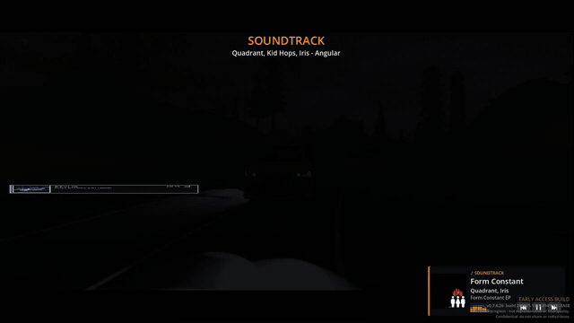</a> <a href="docs/media/clips/glare.mp4">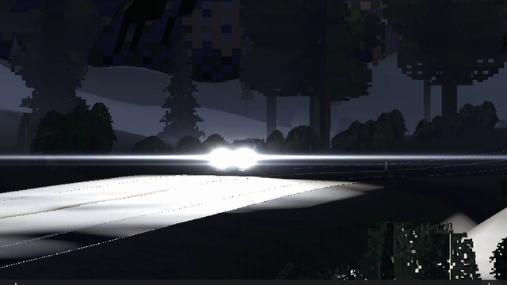</a>

[**Download the latest version**](https://github.com/ArthurJClack/shitboxrally-releases/releases/latest) ·
[All releases](https://github.com/ArthurJClack/shitboxrally-releases/releases) ·
[Website](https://arthurjclack.github.io)

---

## In action

<a href="docs/media/clips/battle.mp4">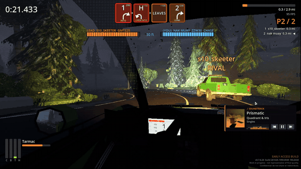</a> <a href="docs/media/clips/results.mp4">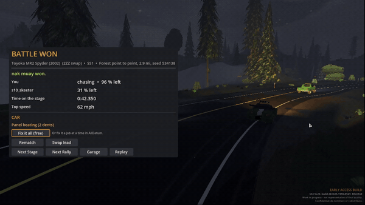</a>
<a href="docs/media/clips/wheel.mp4">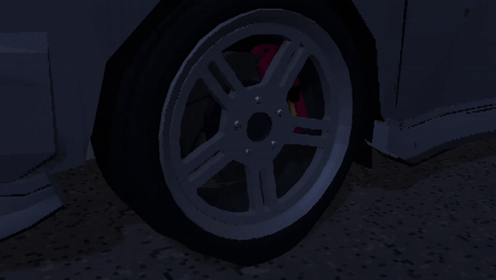</a> <a href="docs/media/clips/fog_beams.mp4">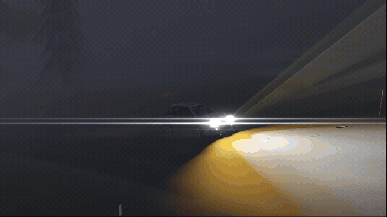</a>
<a href="docs/media/clips/night_side_1.mp4">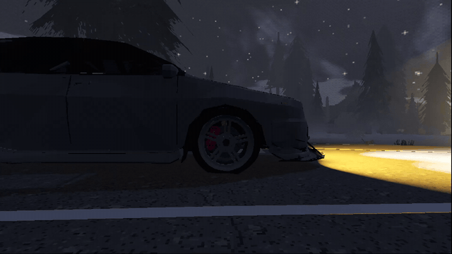</a> <a href="docs/media/clips/night_side_2.mp4">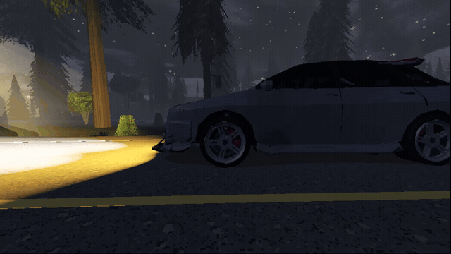</a>

**Garage computer**

<a href="docs/media/clips/ecu.mp4">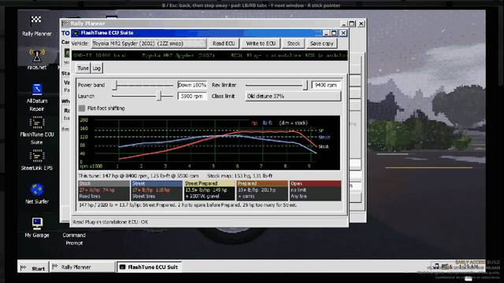</a> <a href="docs/media/clips/ailab.mp4">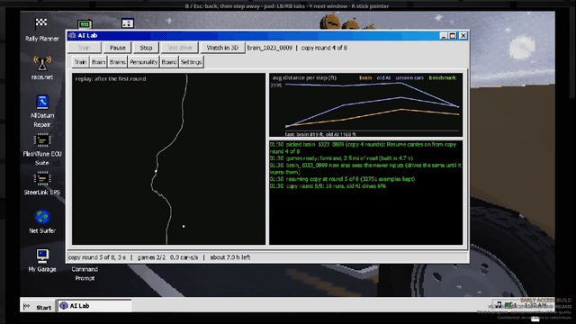</a>
<a href="docs/media/clips/alldatum_repair.mp4">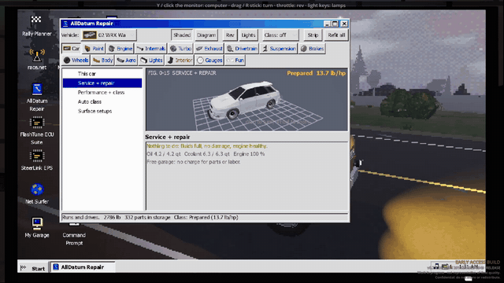</a> <a href="docs/media/clips/alldatum_parts.mp4">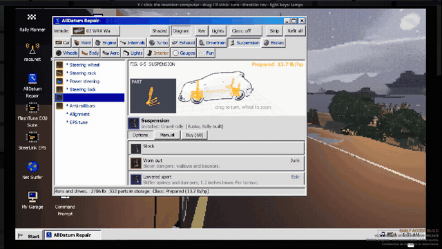</a>

Click a clip for the full-quality video with sound.

## What is it

You get a car that should've been scrapped years ago and a stage nobody's driven before. Every
stage is built fresh: gravel, broken tarmac, snow, mud, fords, cattle grids, potholes, the lot.
Your co-driver calls it, your suspension feels it, and your radiator probably doesn't survive it.

It looks like a game you rented in 2001 and it drives like a sim.

## Features

### Stages
- **Endless procedurally generated stages** - forests, farmland, alpine passes, desert, tundra.
  No two runs are the same, and every stage gets pace notes.
- **Real roads too** - stages built from real-world roads in California, Colorado, the Alps and
  Washington, with their real shape and elevation.
- **14 surfaces** - tarmac in every state of decay (old, washed-out, broken), loose, packed and
  hard-packed gravel, mud, snow, packed snow and more. The loose stuff gets dug up as the field goes
  through, and stones fly off and bounce off your car.
- **Roads that are actually beat up** - potholes, patches, cracks, tar snakes, washboard, cattle
  grids, puddles, fords, ponds, spills, fallen leaves. All of it called by the co-driver.
- **Weather** - rain with real puddle splashes, wet stages that dry out as the field goes through,
  snow, fog, night.

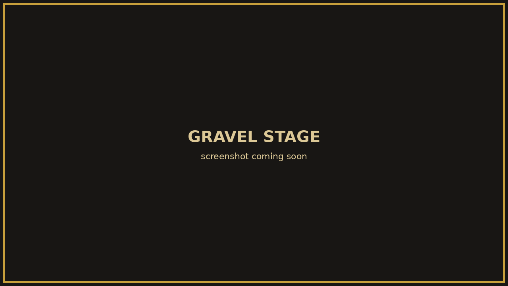 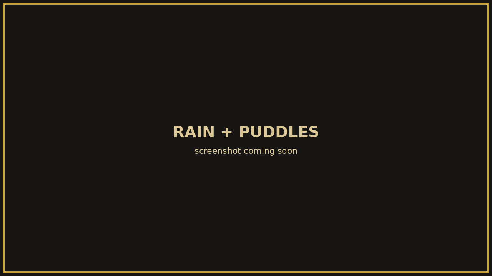

### Driving
- **Heavy physics sim** - raycast suspension, a proper tire model, real drivetrains and limited-slip
  diffs that lock harder on the throttle than off it.
- **Stuff wears out** - clutches fade when you cook them, turbos heat-soak, a money shift costs
  you the engine, radiators get holed, engines overheat (you'll see the steam), cars burn fuel and
  get lighter. Thin air up in the mountains means less power.
- **Damage that sticks** - dents, knocked-out alignment, ground the floorpan and you'll hear it.
- **Steering wheel force feedback** - MOZA, Fanatec, Logitech, Thrustmaster, Simagic. You feel the
  car's real steering torque: tire grip, caster, every bump and pothole. The wheel goes light when
  the front washes out. MOZA bases are set up automatically.
- **Night driving** - halogens and HIDs that warm up like the real thing, fog lamps, and a lot of
  darkness.

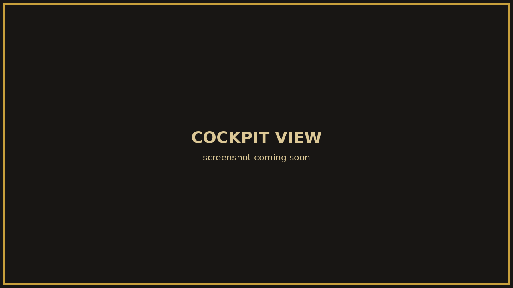 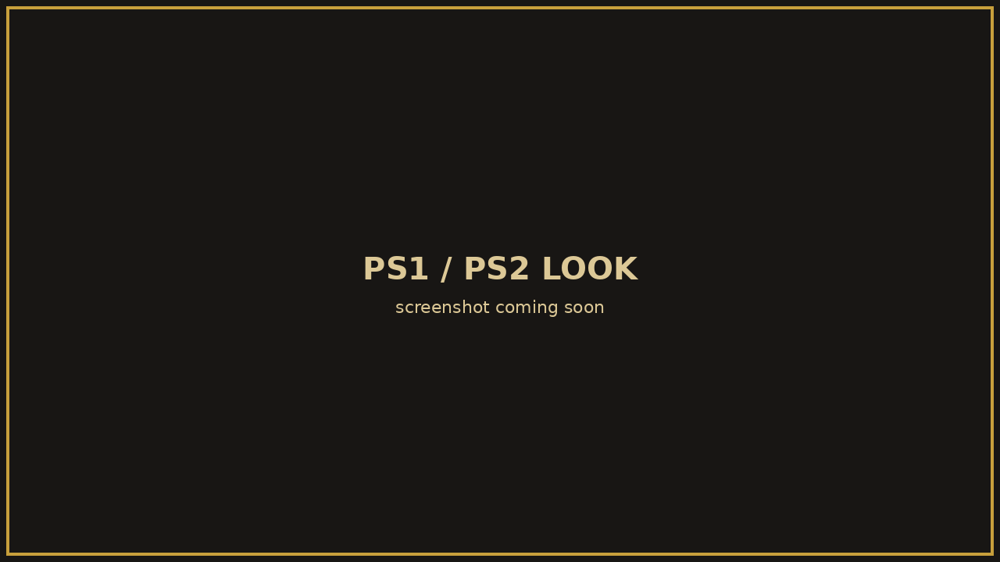

### Multiplayer
- **Online with friends** - Steam lobbies, or join by IP / LAN. Rolling starts, shared stages,
  live standings.
- **Split-screen** on one PC.
- **Push-to-talk voice** that sounds like a CB radio, and gets worse the further apart you are.
- **Car radio** - drop your own music in a folder and it's a radio station. Your friends hear it
  coming out of your car.
- Bring any car from your garage - your friends see your build.

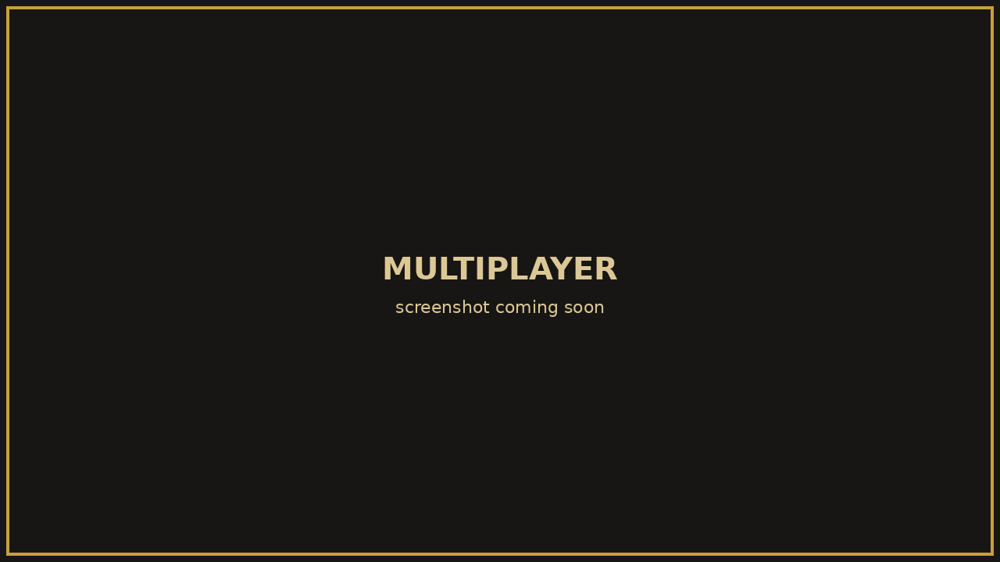 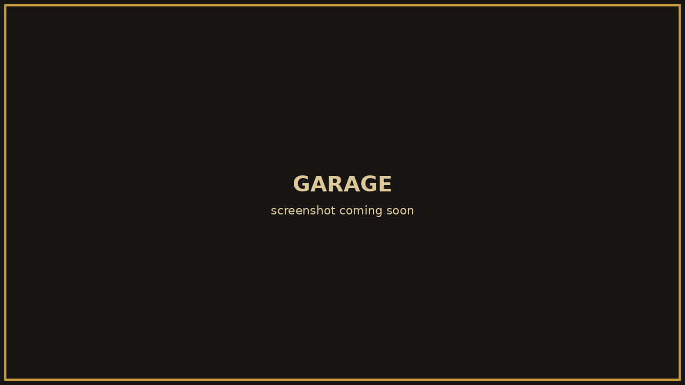

### Garage
- A pile of cheap old cars, each with its own steering ratio, lock and quirks.
- Parts and upgrades: engine, tires, suspension, radiators, roll cages and more.

### Looks and performance
- **PS1/PS2 look** - wobbly low-res rendering, banding and dithering, pixel cars. You can turn it
  down if it hurts.
- **Graphics presets** from Potato to Native. They only change what's drawn, never the physics.
  Older and integrated GPUs pick one automatically.
- **Cinematic cams** - car-mounted action cams, fly-bys and chase shots. Press K mid-race.

## Download and install

1. Go to the [**latest release**](https://github.com/ArthurJClack/shitboxrally-releases/releases/latest).
2. Download **`ShitboxRally_Setup.exe`** and run it. It grabs the game and sets it up for you.
   (Prefer no installer? Grab **`ShitboxRally-win64.zip`**, unzip it anywhere and run the exe.)
3. Play. The game checks for updates when it starts, so you only install once.

Windows may show a SmartScreen warning because the game isn't signed. Click **More info → Run anyway**.

### Stable vs dev builds

| | Stable | Dev |
|---|---|---|
| **What** | Full releases | Test builds with the newest stuff |
| **Where** | [Latest release](https://github.com/ArthurJClack/shitboxrally-releases/releases/latest) | [Pre-releases](https://github.com/ArthurJClack/shitboxrally-releases/releases) |
| **Will it break?** | Hopefully not | Probably, a bit |
| **Updates** | Only to the next stable release | To every new dev build |

The channel is baked into the build you install, so a stable install stays stable. If you want to
help test, install a dev build. Found a bug? Use **Settings → Stats & feedback** in the game. It goes
straight to the dev.

### System requirements

Rough guide, not a promise:

- **OS:** Windows 10 or 11, 64-bit
- **GPU:** anything with Vulkan or OpenGL 3.3. Older GPUs fall back to OpenGL automatically and the
  Potato preset runs on integrated graphics.
- **Disk:** about 1 GB
- **Controls:** keyboard works, a gamepad is better, a wheel with force feedback is best.

## Patch notes

Every release has its notes on the [releases page](https://github.com/ArthurJClack/shitboxrally-releases/releases).

## Links

- Website: [arthurjclack.github.io](https://arthurjclack.github.io)
- Bugs and ideas: **Settings → Stats & feedback** in the game

---

(c) 2026 fish market software. All rights reserved. This repo only hosts the game's builds.
Please don't re-upload or share the files.
