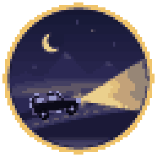
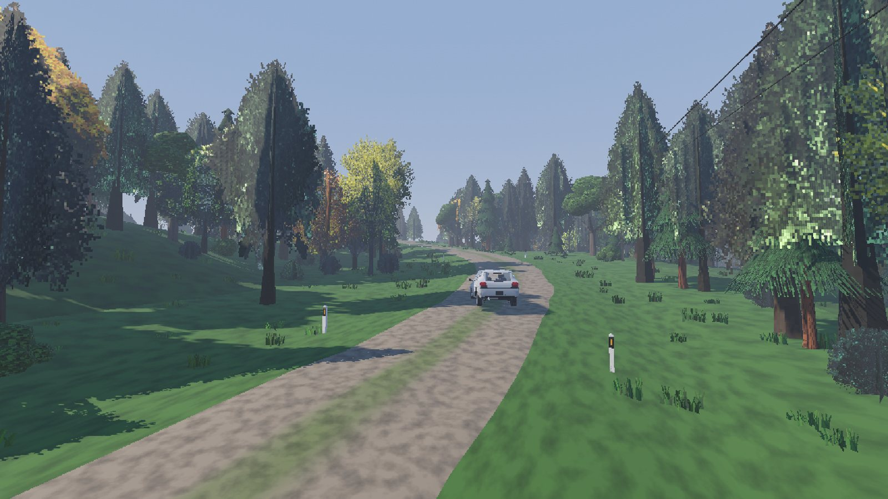
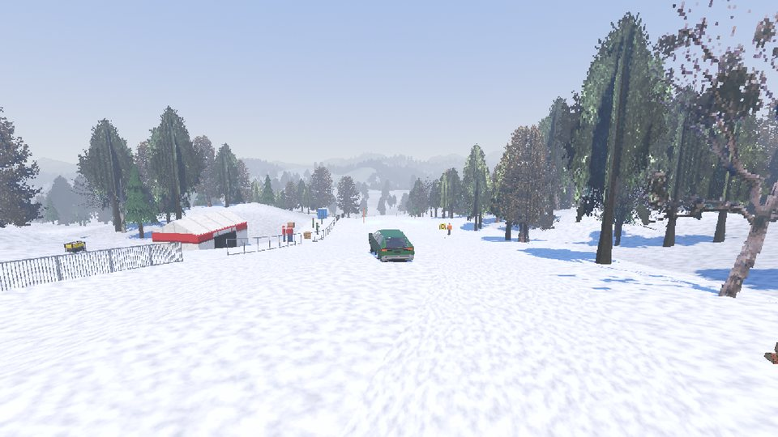
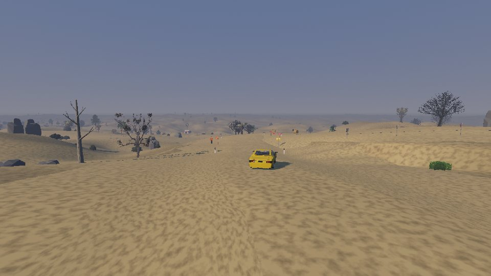
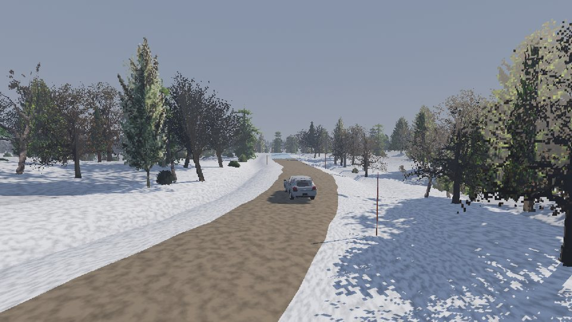
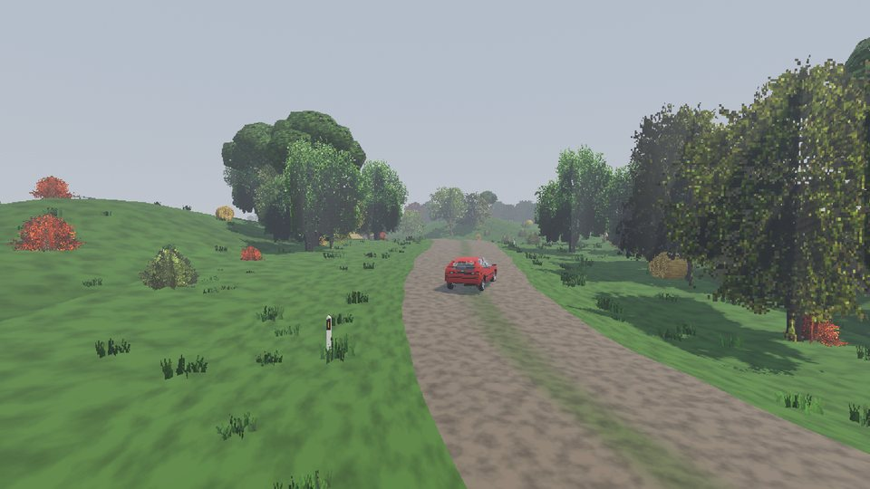

  

<h1 align="center">Shitbox Rally</h1>

  Rally racing in tired old cars on procedurally generated stages. 
  Heavy physics, loose gravel, potholes, fords, and a PS1/PS2 look.

  
  

  
  
  

  

## Get the game

1. Download the **[Windows installer](https://github.com/ArthurJClack/shitboxrally-releases/releases/latest/download/ShitboxRally_Setup.exe)** and run it. It fetches the newest version of the game and installs it.
2. Or grab the **[zip](https://github.com/ArthurJClack/shitboxrally-releases/releases/latest/download/ShitboxRally-win64.zip)**, unzip it anywhere and run `ShitboxRally.exe`.

Windows may warn that the installer is from an unknown publisher. Click **More info → Run anyway**.

## Updates

You only download once. When a new version comes out, the title screen says **Update available**. Click it and the game downloads the update, restarts and you're on the new version.

What changed in each version is on the [releases page](https://github.com/ArthurJClack/shitboxrally-releases/releases).

## Screenshots

  
  

  
  

## Want the newest stuff first?

Dev builds go to **[shitbox-rally](https://github.com/ArthurJClack/shitbox-rally)**. They come out more often and can be broken. Once you install one, your game updates to every new dev build and to every normal release.

---

© 2026 fish market software. All rights reserved. For players of Shitbox Rally only. Please don't re-upload or share the files.
